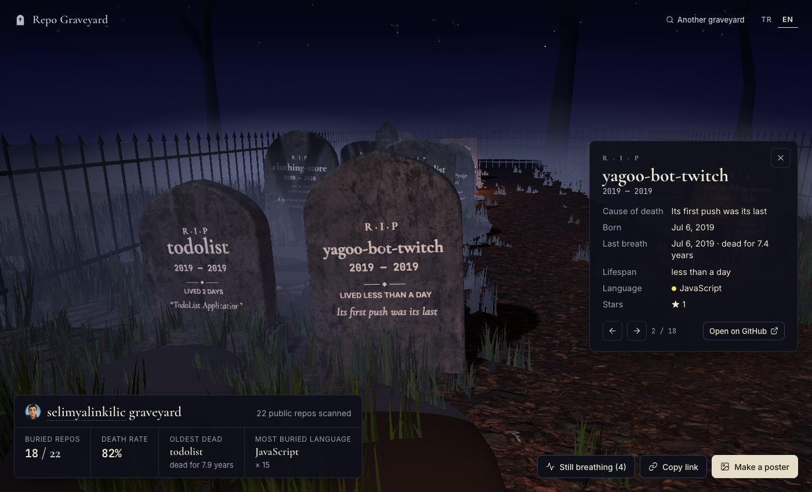
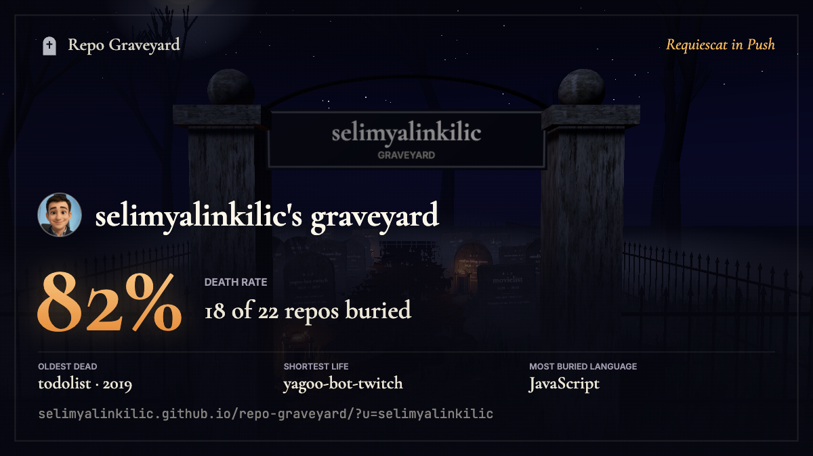

<h1 align="center">🪦 Repo Graveyard</h1>

<p align="center">
  <b>Walk through a 3D graveyard of your abandoned GitHub repos.</b><br>
  Every repo gets a tombstone, a lifespan and a cause of death. Get your death rate and a poster to share.
</p>

<p align="center">
  <a href="https://selimyalinkilic.github.io/repo-graveyard/"><b>Open Repo Graveyard →</b></a><br>
  <sub>English · <a href="README.tr.md">Türkçe</a></sub>
</p>

<p align="center">
  
</p>

## What it does

Type a GitHub username. Repo Graveyard reads that user's public repos, finds the ones nobody has pushed to in a while and buries them:

- **A tombstone per dead repo** with its name, birth and death years, lifespan and its description as the epitaph.
- **A cause of death** for each one: *"The world didn't need another todo app"*, *"A one-commit life"*, *"Replaced by a newer portfolio"*, *"A new framework came out"*…
- **Stones age with neglect.** The longer a repo has been abandoned, the more moss it grows; after three years it cracks.
- **Walk around.** Scroll, drag or use the arrow keys. Click a stone to read it, then use ← → to move between graves.
- **Your stats:** buried repos, death rate, oldest dead, shortest life, most buried language.
- **A poster to share** for X (16:9), Instagram (4:5) or Stories (9:16), made from your own graveyard.
- **Still breathing:** your active repos are listed too, so you know which ones are next.

You can choose when a repo counts as dead (6 months, 1 year, 2 years) and whether forks are buried too. The page works in English and Turkish.

<p align="center">
  
</p>

## Privacy

There is no server. Your browser talks to the public GitHub API directly, and only public repos are visible. Nothing is stored or tracked.

The unauthenticated GitHub API allows 60 requests per hour per IP. One graveyard takes 2 requests or more, depending on how many repos the user has.

## Run it locally

No build step: it's plain HTML, CSS and JavaScript modules.

```bash
git clone https://github.com/selimyalinkilic/repo-graveyard
cd repo-graveyard
python3 -m http.server 8765    # then open http://localhost:8765/?u=<username>
npm test                       # rule tests (Node 20+)
```

Add `?2d=1` to the URL for the lightweight 2D view. It is also used automatically when WebGL 2 isn't available.

## How it's built

| File | What it does |
|---|---|
| `core.js` | Pure logic: dead/alive rules, causes of death, stone looks, stats. Covered by `tests/`. |
| `scene.js` | The 3D graveyard ([three.js](https://threejs.org)): procedural tombstones with carved inscriptions, gate, fence, lanterns, fog, swaying grass. |
| `poster.js` | Renders the share poster from the 3D scene onto a canvas. |
| `app.js` | UI, GitHub API, English/Turkish text. |

## Credits

- Textures and models: [Poly Haven](https://polyhaven.com) (CC0)
- Icons: [Lucide](https://lucide.dev) (ISC)
- Fonts: Cormorant Garamond, Inter, JetBrains Mono (OFL)

## License

[MIT](LICENSE) © Selim Yalınkılıç
