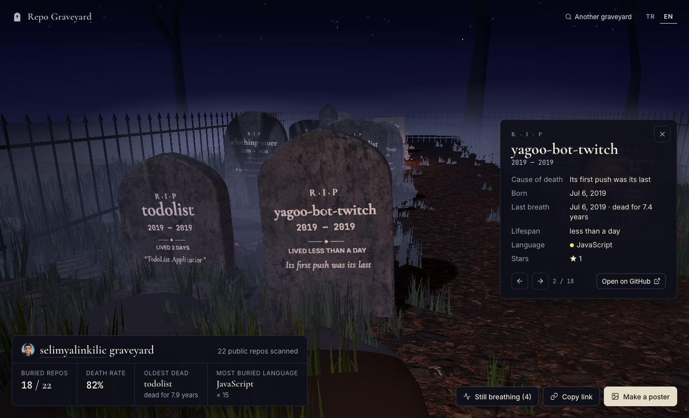

<h1 align="center">🪦 Repo Graveyard</h1>

<p align="center">
  <b>Terk ettiğin GitHub repolarını 3D bir mezarlıkta gez.</b><br>
  Her repo bir mezar taşı, bir ömür ve bir ölüm sebebi alır. Ölüm oranını öğren, paylaşmak için posterini al.
</p>

<p align="center">
  <a href="https://selimyalinkilic.github.io/repo-graveyard/?lang=tr"><b>Repo Graveyard'ı aç →</b></a><br>
  <sub><a href="README.md">English</a> · Türkçe</sub>
</p>

<p align="center">
  
</p>

## Ne yapar?

Bir GitHub kullanıcı adı yazarsın. Repo Graveyard o kullanıcının herkese açık repolarını okur, bir süredir push almayanları bulur ve gömer:

- **Her ölü repoya bir mezar taşı:** adı, doğum ve ölüm yılı, ömrü ve kitabe olarak açıklaması.
- **Bir ölüm sebebi:** *"Dünyanın bir todo uygulamasına daha ihtiyacı yoktu"*, *"Tek commit'lik bir ömür"*, *"Yeni portfolyo yüzünden terk edildi"*, *"Yeni bir framework çıktı"*…
- **Taşlar ihmalle yaşlanır.** Repo ne kadar uzun süredir terk edilmişse taşta o kadar yosun olur, üç yıldan sonra taş çatlar.
- **Mezarlıkta dolaşabilirsin:** kaydır, sürükle ya da ok tuşlarını kullan. Bir taşa tıkla, ← → ile mezarlar arasında gez.
- **İstatistiklerin:** yatan repo, ölüm oranı, en eski ölü, en kısa ömür, en çok gömülen dil.
- **Paylaşım posteri:** X (16:9), Instagram (4:5) ve Story (9:16) için, kendi mezarlığından üretilir.
- **Hâlâ nefes alanlar:** aktif repoların da listelenir, sıradakilerin hangileri olduğunu görürsün.

Bir reponun ne zaman ölü sayılacağını (6 ay, 1 yıl, 2 yıl) ve fork'ların da gömülüp gömülmeyeceğini seçebilirsin.

## Gizlilik

Sunucu yok. Tarayıcın doğrudan GitHub'ın herkese açık API'sine bağlanır ve yalnızca herkese açık repolar görünür. Hiçbir şey kaydedilmez ya da izlenmez.

## Yerelde çalıştırma

```bash
git clone https://github.com/selimyalinkilic/repo-graveyard
cd repo-graveyard
python3 -m http.server 8765    # sonra http://localhost:8765/?u=<kullanıcı-adı>
npm test
```

## Lisans

[MIT](LICENSE) © Selim Yalınkılıç · Dokular ve modeller: [Poly Haven](https://polyhaven.com) (CC0)
